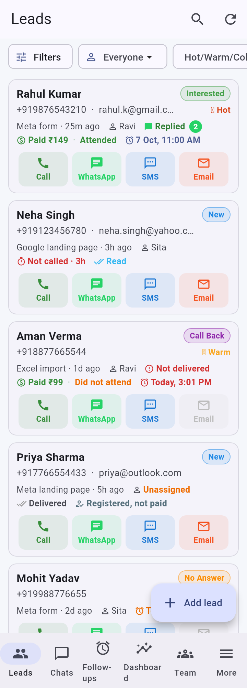
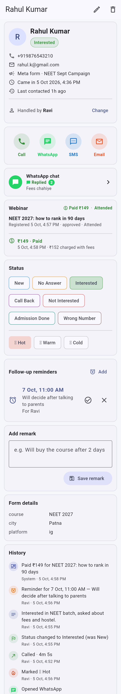
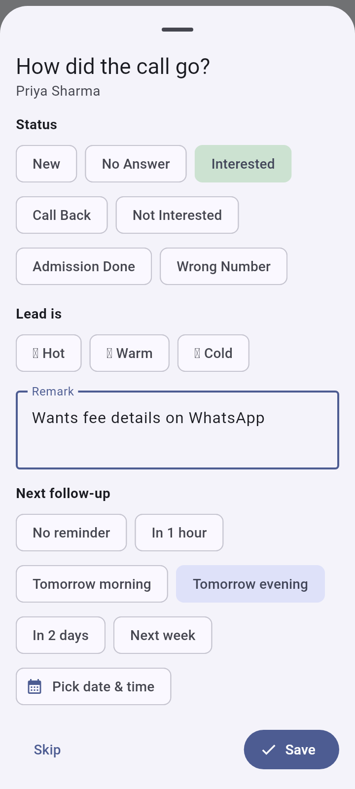
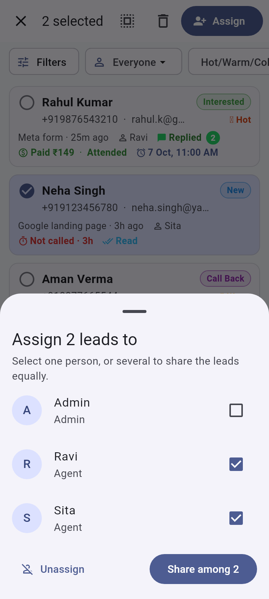

# WhatsWeb

Personal use ke liye Android CRM app — Meta / Google Ads aur Excel se aaye leads (bachchon)
ko call, WhatsApp, SMS, email karna, status/remark/reminder lagana, aur team mein leads baantna.

**Setup:** [docs/SETUP.md](docs/SETUP.md)

| Leads | Lead profile | Call ke baad | Assign |
|---|---|---|---|
|  |  |  |  |

(Screenshots sample data ke saath: `flutter test tool/screenshots/screens_test.dart --update-goldens`)

## Kya kya hai

- **Leads list** — naam, number, status; har lead pe Call / WhatsApp / SMS / Email button
- **Search + filter** — status se, agent se, "Unassigned"
- **Lead profile** — status badalna, remark, follow-up reminder, poori history
  (kisne kab call kiya, kya status diya)
- **Call ke baad popup** — app pe wapas aate hi "call kaisi rahi?" (status + remark + next reminder)
- **Reminders** — time pe phone notification, usi mein Call / WhatsApp button
- **Follow-ups tab** — Overdue / Today / Upcoming
- **Admin** — leads select karke assign (ek ko ya kai logon mein baraabar baantna),
  team add/deactivate, har agent ke leads ka count, Excel/CSV import, CSV export (backup),
  status list aur message templates badalna, auto-assign
- **Agent** — sirf apne assigned leads dikhte hain (database level pe lock)
- **Call record** — phone ki call history se: kab call hui, kitni der baat hui; call na uthe to
  "No Answer" apne aap
- **Dashboard** (admin) — kis agent ne kitni call ki, talk time, admissions, kaunse ad / form se
  admission aaye, "Not Interested" ki wajah
- **Targets + Leaderboard** — daily call / monthly admission target, team ranking ("My stats")
- **Kai message templates** — Course details, Fees, Brochure… bhejte waqt chuno
- **Hot / Warm / Cold** tag, "Not called · 25m" badge
- **Push notifications** — nayi lead turant agent ko, 15 min tak call na ho to alert (aur chahe
  to lead doosre agent ko), subah 9 baje summary (Firebase setup ke baad)
- **App lock** — 4 digit PIN; admin sabke liye zaroori kar sakta hai
- **App ke andar update** — naya version aane pe app khud batati hai
- **Google Drive backup** — har raat saare leads + history
- **Duplicate check** — same number dobara aaye to naya lead nahi banta, history mein
  "Enquired again" likha aata hai
- **Webhooks** — landing page / website forms, Google Ads lead form, Meta Instant Form
- **Filter** — landing page / form / campaign, Excel file, date, WhatsApp state; **Imported files**
  mein har Excel upload ek folder
- **WhatsApp Cloud API** — lead aate hi apne aap template (ON/OFF), har type ka template (heading
  text / picture / video / PDF / location, quick-reply / link / call / copy-code buttons),
  Meta approval status, inbox + chat (Sent / Delivered / Read ticks), button dabane se status
  aur Hot-Warm-Cold apne aap, automatic replies (buttons / list), reply na aane pe follow-up,
  STOP, broadcast, number type karke seedha template bhejna, dashboard mein sent / delivered / read / replied

- **Filters mein ek se zyada source** — Leads → Filters → "Where the lead came from": jitne chaho tick karo (campaign, page, Excel file), unmein se kisi ek wali leads dikhti hain. Broadcast ke audience mein bhi wahi.
- **Webinar.gg** — registration / payment / refund apne aap lead pe (Paid ₹149, Attended...), alag
  webinar ka paisa, dashboard card, broadcast filter. More → Webinar.gg; steps docs/SETUP.md mein.
- **AIFM Education app (Appx)** — app ka signup, khareed, cancel hua payment, refund apne aap lead pe
  (Admission Done, course + amount), khareedne wale ko "pay nahi kiya" reminder nahi, dashboard card, filter.
  More → AIFM Education app; steps docs/SETUP.md mein.
- **REST API + outgoing webhooks (AI assistant ke liye)** — API key (ek baar dikhti hai, revoke ho sakti hai, 60 request/minute),
  students / activities / courses / WhatsApp templates / messages padhna, template ya text bhejna (24 ghante ka window aur STOP ka
  dhyan), note aur status, aur signed webhooks (retry + delivery log). More → API & webhooks; poori list docs/API.md mein.
- **Claude connector** — Claude app se CRM ka summary, chats padhna, aur kaam ki request (status, assign, remark,
  reminder, WhatsApp, naye leads, WhatsApp template + button-reply flow + "pay nahi kiya to reminder"): har cheez ka
  ON/OFF, har kaam pe aapka Approve, template sirf DRAFT (Meta ko aap bhejte ho), delete kabhi nahi. More → Claude
  connector; steps docs/SETUP.md mein.
- **Computer (browser) version** — wahi app Chrome mein; side bar, wide screen. Har build mein zip
  (hosting baad mein)

## Folder

| Path | Kya hai |
|---|---|
| `lib/` | Flutter app (Android) |
| `supabase/migrations/0001_init.sql` | Database tables, security rules, functions |
| `supabase/functions/` | Server functions: team management, lead webhooks, Meta leads |
| `landing-page/index.html` | Sample landing page form jo seedha CRM mein lead bhejta hai |
| `scripts/supabase-deploy.sh` | Supabase ko apne aap set/update karta hai (database, functions, settings) |
| `.github/workflows/build-apk.yml` | Har push pe: pehle Supabase update, phir free mein APK |

## Tech

Flutter 3.47 · Supabase (Postgres + Auth + Edge Functions, free plan) · local notifications
